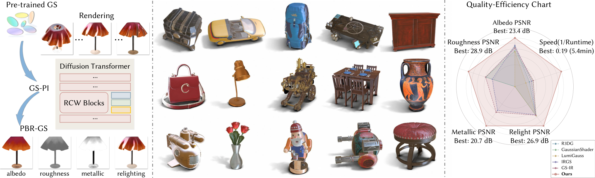
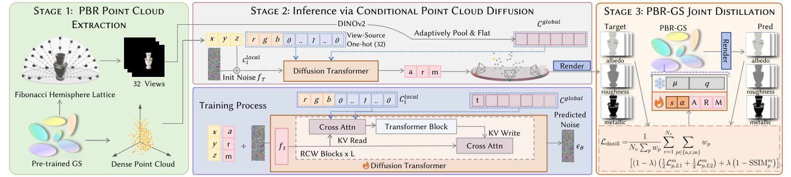

<div align="center">

# GS-PI

### An Optimization-Decoupled Appearance Decomposition Approach for Generating PBR Gaussian Assets

**Jieting Xu · Rengan Xie · Zijian Huang · Zehui Jin · Rui Wang · Yuchi Huo**

State Key Laboratory of CAD&CG, Zhejiang University

[](https://arxiv.org/abs/2609.19907)
[](#installation)
[](#installation)
[](LICENSE)

[Paper](https://arxiv.org/html/2609.19907) · [PDF](https://arxiv.org/pdf/2609.19907) · [Training](#training) · [Evaluation](#evaluation) · [中文说明](README_zh-CN.md)

</div>

⭐ If you find GS-PI useful or enjoy our work, please consider giving this repository a **Star**! It would make the authors very happy. Thank you for your support! 🥰✨



GS-PI generates physically based material attributes on fixed 3D geometry. A conditional point diffusion model combines global DINOv2 features, source-anchored RGB observations, and source-view indicators to predict **albedo, roughness, and metallic**. The full paper pipeline transfers these predictions back to Gaussian primitives through a separate distillation stage.

This repository provides training and evaluation code for **Stage II: conditional point-cloud material diffusion**. It supports the two-stream Read–Compute–Write (RCW) backbone and a standard point Transformer, with condition precomputation, checkpoint resumption, DDIM sampling, and PLY/NPZ export. An additional configuration jointly predicts materials and world-space normals.

## Method



The full method has three stages: extract a point cloud from reconstructed Gaussians, predict PBR features on fixed geometry, and distill those features onto the original Gaussians. The figures illustrate the paper’s pipeline and results.

Stage II uses a PointInfinity-inspired RCW transformer with:

- **Global context:** frozen DINOv2 features pooled to a `5 × 5` grid per canonical view.
- **Local observations:** RGB from the source view that generated each point.
- **View conditioning:** a 32-way source-view indicator, expanded inside the network.
- **Feature-only diffusion:** fixed coordinates and five material channels, with a cosine noise schedule and Min-SNR weighting.

The `gs_pi_pbr.yaml` example samples 512 points and 16 of 32 DINO views during training. Full-object evaluation uses all points and all 32 views, with 50 DDIM steps by default.

## Installation

```bash
git clone https://github.com/Valentina-tinder/GS-PI_.git
cd GS-PI_
```

Use Python 3.10+ and install a PyTorch/torchvision pair compatible with your CUDA environment. The tested pair is **PyTorch 2.4.1 / torchvision 0.19.1**.

```bash
python -m pip install -e '.[test,data]'
```

The `data` extra adds OpenCV and pandas for optional EXR checks and quality filtering. For NPZ inputs, `.[test]` is sufficient. xFormers is optional; install a version compatible with your PyTorch/CUDA stack if you enable it. The example configurations default to standard attention. CPU is supported for the smoke test and unit tests.

## Data preparation

Prepare separate training and test objects using the [data specification](docs/DATA.md). The original PLY interface expects a merged point cloud, view metadata, multi-view RGB images (`Render_1.png` through `Render_32.png`), and condition caches. Image indices must match the view metadata. An NPZ interface is also available for custom datasets.

```text
data/
  train/<object_id>/
    metadata.json
    Render_1.png ... Render_32.png
    extract_output/merged_model_render_color.ply
  test/<object_id>/...
  dino/train/<object_id>.pt
  dino/test/<object_id>.pt
  topk1/train/<object_id>.pt
  topk1/test/<object_id>.pt
```

With the input files in place, precompute conditions as follows:

```bash
export NPCD_DINOV2_REPO=/path/to/dinov2

python scripts/tools/extract_features_multiview.py \
  --root-dir data/train --save-dir data/dino/train \
  --num-views 32 --device cuda

python scripts/tools/precompute_topk_cond_point_features.py \
  --dataset-root data/train --output-dir data/topk1/train \
  --num-views 32 --top-k 1 --device cpu
```

Repeat for the test split. Install [DINOv2](https://github.com/facebookresearch/dinov2) separately; its first use may download pretrained weights. Training and evaluation use cached tokens and do not instantiate DINOv2. Keep the image projection seed and feature space consistent with the checkpoint, and compute point conditions from the exact PLY and point order used for training.

## Training

Edit the paths in [`configs/gs_pi_pbr.yaml`](configs/gs_pi_pbr.yaml). Paths are resolved relative to the current working directory.

```bash
python train.py --config configs/gs_pi_pbr.yaml \
  --output outputs/gs_pi --device cuda --dtype bfloat16 --num-workers 4
```

For multiple GPUs:

```bash
torchrun --standalone --nproc_per_node=4 train.py \
  --config configs/gs_pi_pbr.yaml --output outputs/gs_pi_ddp \
  --dtype bfloat16 --num-workers 4
```

The effective batch size is `batch_size × number of processes × gradient_accumulation_steps`. The public trainer uses AdamW with a fixed learning rate, gradient clipping, EMA, AMP and DDP. It saves `config.yaml`, `metrics.jsonl` and `checkpoint.pt`.

To resume, set `max_iterations` to the desired **total** number of updates:

```bash
python train.py --config configs/gs_pi_pbr.yaml --output outputs/gs_pi \
  --resume outputs/gs_pi/checkpoint.pt --dtype bfloat16
```

Resumption restores weights, EMA, optimizer, scaler and iteration count. The data cursor and RNG state are reinitialized.

| Configuration | Purpose |
| --- | --- |
| [`gs_pi_pbr.yaml`](configs/gs_pi_pbr.yaml) | Recommended Stage II starting point: RCW, PBR5, fixed coordinates, 16/32 training views |
| [`two_stream_pbr.yaml`](configs/two_stream_pbr.yaml) | Earlier portable RCW example; different coordinate/view settings |
| [`transformer_pbr.yaml`](configs/transformer_pbr.yaml) | Standard global-attention Transformer |
| [`transformer_normal.yaml`](configs/transformer_normal.yaml) | Material + world-normal prediction extension |

## Evaluation

```bash
python evaluate.py --config configs/gs_pi_pbr.yaml \
  --checkpoint outputs/gs_pi/checkpoint.pt --state-key ema_model_state_dict \
  --output outputs/gs_pi_test --device cuda --steps 50
```

The evaluator processes each complete object in its original point order. It writes:

- `<object_id>.npz`: coordinates, predicted features and ground-truth features.
- `<object_id>.ply`: coordinates and predicted PBR attributes; optional world normals.
- `metrics.json`: per-object material MAE/MSE, optional normal angular error, and averages over objects.

Evaluation computes aligned point metrics and requires ground-truth material features. For prediction without GT, call `gs_pi.runtime.sample_features` directly.

Use `--sampled` to evaluate the configured number of sampled points when memory is limited. Full-object inference processes all points together; the standard Transformer has quadratic attention cost.

The loader also accepts compatible original diffusion/NPCD checkpoints, stripping wrapper prefixes and ignoring PointNeRF weights while strictly checking diffusion parameters. Match backbone, channel schema, widths and condition layout.

## Smoke test and tests

Use the small random synthetic dataset below to check installation, training, and evaluation on CPU.

```bash
python examples/make_toy_data.py --output data/toy
python train.py --config data/toy/config.yaml --output outputs/toy --device cpu
python evaluate.py --config data/toy/config.yaml \
  --checkpoint outputs/toy/checkpoint.pt --state-key ema_model_state_dict \
  --output outputs/toy_eval --device cpu --steps 2
python -m pytest -q
```

Validation covers training, save/resume, EMA inference, PLY/NPZ export, conditioning, and feature/normal losses. The GitHub workflow runs CPU tests and a package build.

## Citation

If this work is useful to your research, please cite:

```bibtex
@article{xu2026gspi,
  title   = {{GS-PI}: An Optimization-Decoupled Appearance Decomposition Approach for Generating {PBR} Gaussian Assets},
  author  = {Xu, Jieting and Xie, Rengan and Huang, Zijian and Jin, Zehui and Wang, Rui and Huo, Yuchi},
  journal = {arXiv preprint arXiv:2609.19907},
  year    = {2026},
  eprint  = {2609.19907},
  archivePrefix = {arXiv},
  doi     = {10.48550/arXiv.2609.19907},
  url     = {https://arxiv.org/abs/2609.19907}
}
```

Machine-readable citation files: [`CITATION.cff`](CITATION.cff) and [`CITATION.bib`](CITATION.bib).

## Acknowledgments and license

The diffusion code builds on Neural Point Cloud Diffusion (NPCD), and the two-stream backbone follows the Read–Compute–Write design of [PointInfinity](https://openaccess.thecvf.com/content/CVPR2024/html/Huang_PointInfinity_Resolution-Invariant_Point_Diffusion_Models_CVPR_2024_paper.html). Image conditioning uses [DINOv2](https://github.com/facebookresearch/dinov2).

Code is distributed under the [MIT license](LICENSE), retaining the upstream copyright notice. The [paper figures](assets/paper/README.md) retain their original attribution and are separate from the code license.
